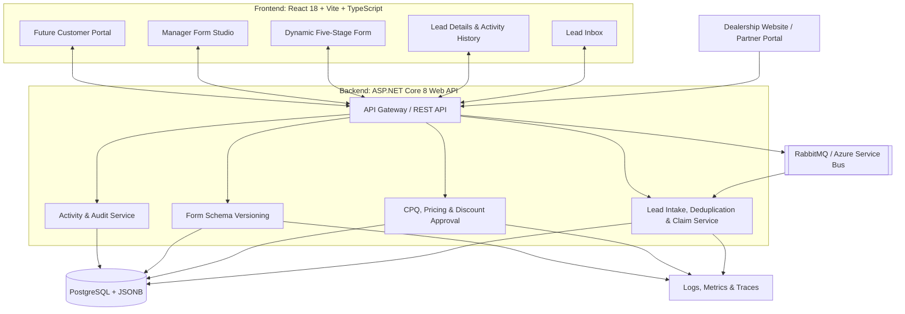

# System Design Document: Keyloop Sales Lead & CPQ Platform (Scenario C)

## 1. Overview

This document describes the proposed design for **Scenario C: Sales Lead
Management Tool**. The goal is to help dealership salespeople manage
website leads, view customer details, and record follow-up activities.
The design also allows the platform to grow into a metadata-driven
Configure, Price, Quote (CPQ) workspace.

### Main Requirements

- Show incoming leads in a searchable inbox.
- Display lead details and follow-up activities in chronological
  order.
- Let salespeople add activities and save them permanently.
- Handle duplicate inquiries and prevent two representatives from
  claiming the same lead.
- Support versioned dynamic forms, quotes, discount approvals, and
  future customer self-service.

### Assumptions

1.  Website and partner inquiries arrive through `POST /webhooks/leads`.
2.  Leads without an owner appear in an **Unassigned Pool**. Claiming a
    lead must be safe when multiple representatives try at once.
3.  Managers can update and publish versioned form schemas without
    redeploying the frontend, provided the schema uses supported form
    features.
4.  The consultation form has five stages: `J1: Basic`,
    `J2: Product/Price`, `J3: DAP`, `J4: Quote`, and `J5: Master CAF`.
5.  The backend calculates final quote prices and applies discount
    rules. The browser cannot decide the final price.
6.  The customer self-service EV portal is a future extension, not a
    required first release.

## 2. High-Level Architecture

### Component Roles

- **Frontend:** Shows leads, details, activities, dynamic forms,
  quotes, and manager tools.
- **REST API:** Validates requests, checks access, and connects the
  frontend to backend services.
- **Lead Service:** Processes incoming leads, finds duplicates, and
  manages lead ownership.
- **CPQ Service:** Calculates quotes and handles discount approvals.
- **Schema Service:** Saves, validates, and publishes form schema
  versions.
- **Activity Service:** Stores follow-up activities and audit records.
- **Message Queue:** Handles traffic spikes and allows webhook
  processing to run in the background.
- **PostgreSQL:** Stores leads, activities, quotes, and versioned form
  data.
- **Telemetry:** Collects logs, metrics, and traces to help find and
  diagnose problems.

## 3. Data Flow

### 3.1 Lead Intake and Deduplication

1.  A website sends lead details to `POST /webhooks/leads`.
2.  The API checks the request and sends it to the message queue.
3.  A background worker normalizes phone numbers and email addresses,
    then checks for a matching active lead.
4.  A strong match updates the existing lead and adds the new vehicle
    configuration. Otherwise, a new lead is created.
5.  The lead is assigned to a representative or added to the Unassigned
    Pool.
6.  Failed messages are retried. Messages that continue to fail go to a
    dead-letter queue for review.

The process uses idempotency keys so that webhook retries do not create
duplicate records. Name-only matches should not trigger automatic
merging.

### 3.2 Salesperson Workflow and Activity Logging

1.  A representative opens the inbox and filters or searches leads.
2.  Selecting a lead loads its details and chronological activity
    history.
3.  The representative records calls, notes, appointments, or other
    follow-ups.
4.  The API validates and saves each activity with its actor and
    timestamp.
5.  The UI refreshes to show the saved activity.

### 3.3 Claiming an Unassigned Lead

The API updates a lead only if it is still unassigned and its version
has not changed. If two representatives try to claim it, only one
succeeds; the other receives a conflict response. The successful claim
is recorded in the audit history.

### 3.4 Dynamic Form and Schema Updates

Managers edit and validate a draft form schema before publishing it as a
new version. Published versions are not overwritten. New sessions use
the latest version; an existing session stays on its original version or
follows a controlled migration process.

### 3.5 Quote, DAP, and CAF Flow

The backend calculates quote totals using configured prices, taxes, and
discounts. A discount outside the salesperson's allowed limit requires
manager approval. Issued quotes keep their original version; changes
create a new version. The Master CAF stage stores the required customer
and contract information.

## 4. Technology Stack

---

Layer Technology Reason

---

Frontend React 18, Vite, Reusable UI, type
TypeScript, Tailwind safety, and efficient
CSS development.

Backend ASP.NET Core 8 Web API REST APIs, dependency
injection, and
concurrency support.

Database PostgreSQL + JSONB Relational data with
flexible form and
vehicle configuration
fields.

Messaging RabbitMQ or Azure Buffers traffic and
Service Bus supports background
processing and retries.

Authentication OAuth 2.0 / OpenID Secure sign-in and
Connect role-based access.

Observability OpenTelemetry, Helps track errors,
Prometheus-compatible performance, and
metrics, centralized request flow.
logs

Optional storage Redis and object Caching published
storage schemas and storing
generated documents
when needed.

Testing xUnit, Vitest, React Tests backend logic and
Testing Library frontend behavior.

---

Choose either RabbitMQ or Azure Service Bus for the initial deployment;
using both is unnecessary without a specific need.

## 5. Data Model

Main entities:

- **Lead:** Contact details, source, status, owner, timestamps, and
  row version.
- **VehicleConfiguration:** Vehicle details linked to a lead.
- **LeadActivity:** Activity type, notes, actor, timestamp, and lead
  ID.
- **FormSchema:** Schema key, version, status, JSONB definition,
  publisher, and publication time.
- **LeadFormData:** Form values linked to a lead and schema version.
- **Quote / QuoteVersion:** Quote status, price inputs, line items,
  totals, and version history.
- **DiscountApproval:** Requested discount, decision, approver, and
  reason.
- **WebhookEvent:** External event ID, idempotency key, processing
  status, and errors.
- **AuditEvent:** Actor, action, entity, timestamp, and change
  details.
- **CustomerDocument:** Document type, storage location, and related
  quote.

Use database constraints and transactions for important updates. Index
lead status, owner, normalized contact details, activity timestamps, and
quote status. Validate JSON form data against its schema version. Avoid
storing unnecessary personal data and define retention rules.

## 6. API Design

---

Method Endpoint Purpose

---

`POST` `/webhooks/leads` Receive lead events
safely.

`GET` `/api/leads` Search and paginate
leads.

`GET` `/api/leads/{leadId}` Get lead details.

`POST` `/api/leads/{leadId}/claim` Claim an unassigned
lead.

`GET` `/api/leads/{leadId}/activities` Get activity history.

`POST` `/api/leads/{leadId}/activities` Save a follow-up
activity.

`GET` `/api/form-schemas/{schemaKey}/published` Get the published form
schema.

`POST` `/api/form-schemas/{schemaId}/publish` Publish a validated
schema.

`POST` `/api/leads/{leadId}/quotes` Create or calculate a
quote.

`POST` `/api/quotes/{quoteId}/discount-approval` Request discount
approval.

`POST` `/api/discount-approvals/{approvalId}/decision` Approve or reject a
discount.

`GET` `/api/customer/quotes/{quoteId}` Get a
customer-authorized
quote view.

---

Use pagination for lists, idempotency keys for retryable operations, and
row versions or `ETag`/`If-Match` to prevent lost updates. Return clear
error responses: `400` for invalid input, `401` for unauthenticated
requests, `403` for forbidden actions, `404` for missing resources,
`409` for conflicts, and `429` for rate limits.

## 7. Security and Access Control

- Use HTTPS and OAuth 2.0 / OpenID Connect.
- Check permissions in the backend, not only in the UI.
- Separate access for representatives, managers, administrators, and
  customers.
- Limit representatives to leads permitted by assignment and business
  rules. Customers can only access their own records and documents.
- Verify webhook signatures or credentials and reject replayed events.
- Encrypt data in transit and at rest. Store secrets outside source
  code.
- Mask contact details and secrets in logs.
- Validate request sizes and input values. Protect against injection,
  cross-site scripting, and excessive requests.
- Audit lead reassignment, schema publication, quote issuance, and
  approval decisions.
- Define data retention, correction, and deletion rules.

## 8. Reliability, Concurrency, and Scaling

- Use durable queues, bounded retries, and dead-letter handling.
- Make message processing idempotent because a message may be
  delivered more than once.
- Use database transactions for deduplication, lead claims, quote
  changes, and audit writes.
- Use row versions or conditional updates to prevent conflicting
  changes.
- Keep published schemas and issued quote versions immutable.
- Scale stateless API instances and queue workers independently.
- Use indexes and pagination for inbox searches. Add caching only for
  read-heavy data such as published schemas.
- Add replicas or partition large activity tables only if measured
  traffic requires them.
- Provide health checks, graceful shutdown, backups, and tested
  recovery procedures.

## 9. Observability

### Logging

Use structured logs (for example, Serilog) with timestamps, service
name, trace/correlation ID, lead ID, representative ID, schema version,
operation, duration, and error code. Do not log tokens, secrets, or
unmasked customer contact details.

### Metrics

Track key measures such as:

- `lead_response_time_seconds`: time from webhook receipt to the first
  representative activity.
- `lead_ingestion_total`: accepted lead events.
- `lead_deduplication_total`: merged, created, or review-needed leads.
- `lead_claim_conflicts_total`: unsuccessful competing claims.
- `dap_approval_latency_seconds`: time to decide discount requests.
- `form_schema_version_deployments_total`: published schema versions.
- `queue_oldest_message_age_seconds`: oldest queued message age.
- `webhook_processing_failures_total`: failed processing attempts.
- `quote_calculation_duration_seconds`: quote calculation time.

### Tracing and Alerts

Use OpenTelemetry to trace a request from webhook intake through the
queue and worker. Dashboards should show intake volume, queue delay, API
errors, response time, quote latency, and approval backlog. Alert on
sustained failures, growing queues, and unusually high error rates. Set
service targets after measuring real workload.

## 10. Testing and Verification

- **Unit tests:** Deduplication, normalization, pricing, discount
  limits, schema validation, and workflow transitions.
- **Integration tests:** Webhook authentication, idempotency, queue
  retries, database transactions, and concurrent claims.
- **Frontend tests:** Inbox filtering, activity logging, form
  validation, and schema version conflicts.
- **End-to-end tests:** Lead intake through assignment, follow-up,
  quote, approval, and CAF.
- **Security tests:** Role permissions and customer access
  restrictions.
- **Load tests:** Campaign traffic spikes, queue backlogs, and
  database contention.

Critical checks include: repeated webhooks do not create duplicates;
only one representative can claim a lead; activities persist; client
changes cannot manipulate quote totals; required discounts need
approval; and customers cannot access other customers' data.

## 11. Deployment

- Keep development, test/staging, and production environments
  separate.
- Use CI to run tests, security checks, and database migration checks
  before release.
- Build immutable container images and keep secrets outside the
  images.
- Use health checks and rolling or blue-green deployment where
  supported.
- Back up PostgreSQL and documents; test restoration regularly.
- Maintain runbooks for queue replay, schema rollback, credential
  rotation, and recovery.
- Use feature flags for higher-risk changes.

## 12. Future Expansion

1.  **Advanced form rules:** Support more complex conditions and field
    dependencies using a safe, limited expression evaluator.
2.  **Nested forms:** Add reusable sub-forms, such as a trade-in
    appraisal inside a vehicle form.
3.  **Order profiles:** Support different workflows for retail,
    corporate fleet, and diplomatic sales.
4.  **Customer EV portal:** Let customers view quote status, vehicle
    build progress, and CAF documents.
5.  **Multi-dealer support:** Add dealer-specific settings, branding,
    permissions, and price lists.
6.  **External integrations:** Connect CRM, inventory, dealer
    management, financing, and notification systems.
7.  **Lead analytics:** Add reporting and lead scoring when reliable
    data is available.
8.  **Service separation:** Split services only when scale or team
    ownership makes it useful.

## 13. GenAI Collaboration Narrative

GenAI was used as a design and coding assistant, while its suggestions
remained subject to human review.

1.  **Architecture:** AI helped map CPQ concepts, discount approvals,
    and versioned forms to the automotive sales scenario.
2.  **Edge cases:** AI helped identify duplicate inquiries, competing
    lead claims, repeated webhooks, stale schemas, and quote-version
    risks.
3.  **Testing:** AI helped propose tests for pricing, lead claiming,
    schema publishing, and webhook deduplication.
4.  **Verification:** The engineering team must review the design, run
    tests, inspect failures, and confirm the final behavior. AI
    suggestions alone do not prove that code or tests work.

## 14. Main Risks and Mitigations

---

Risk Mitigation

---

Incorrect lead merge Match on strong identifiers; send
uncertain cases for review.

Duplicate webhook Use idempotency keys and database
constraints.

Two reps claim one lead Use atomic updates and row
versions.

Invalid form schema Validate before publishing and keep
published versions immutable.

Incorrect quote Calculate prices on the server and
test business rules.

Queue backlog Monitor queue age, retry safely,
and scale workers.

Customer data exposure Enforce record-level access,
encryption, and log masking.

Too much complexity early Start with a modular application
and split services only when
needed.

---

## 15. Key Decisions and Conclusion

The design uses asynchronous lead intake, PostgreSQL with JSONB,
versioned forms and quotes, concurrency-safe lead claiming, server-side
pricing, and auditable activity history. These choices support reliable
lead handling today while leaving room for CPQ, customer self-service,
and integrations later.

The first implementation should prioritize the assessment's core
requirements: a lead inbox, lead details with chronological activities,
and persistent activity logging. Additional CPQ and scaling features can
be added in stages.
